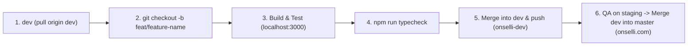

# Onselli

> High-conversion digital product commerce, course hosting, and membership platform tailored for modern African creators.

---

## 1. Environments & Branch Strategy

| Branch | Environment | Live URL | Database / Services | How You Use It |
| :--- | :--- | :--- | :--- | :--- |
| **`feat/*` / `fix/*`** | **Local Feature Branch** | `localhost:3000` | Local / Neon Dev branch | **Created off `dev` for every feature/fix.** Isolated work environment. |
| **`dev`** | **Staging (QA)** | [onselli-dev](https://onselli-dev.vercel.app) | Neon DB (Staging), Bachs Sandbox | **Staging trunk.** Feature branches merge here. Pushing `origin dev` triggers staging deployment. |
| **`master`** | **Production** | [onselli.com](https://onselli.com) | Neon DB (Prod), Live Bachs/Stripe | **Protected production.** Merged from `dev` only after QA verification on staging. |

---

## 2. Standard Feature Branch Workflow



### Step-by-Step Routine:

#### 1. Start from clean `dev`
```bash
git checkout dev
git pull origin dev
```

#### 2. Create your dedicated feature branch
```bash
git checkout -b feat/creator-product-flow
```

#### 3. Build & Verify Locally
- Use the atomic UI primitives in `app/components/ui/` (`Button`, `Input`, `SearchInput`, `Badge`, `Card`, `EmptyState`, `DropdownMenu`).
- Ensure zero errors:
```bash
npm run typecheck
```

#### 4. Commit with Conventional Commits
```bash
git add <files>
git commit -m "feat(products): revamp creator product creation, edit flow, and preview page"
```

#### 5. Merge back to `dev` for Staging Deployment
```bash
git checkout dev
git merge feat/creator-product-flow
git push origin dev
```
*Auto-deploys to **onselli-dev** for live end-to-end testing.*

#### 6. Promote to Production (`onselli.com`)
Once verified on `onselli-dev`:
```bash
git checkout master
git merge dev
git push origin master
git checkout dev
```

---

## 3. Design System & Anti-Slop Guidelines

1. **Restrained Color Palette:**
   - Brand Primary: Deep Emerald (`#006b4c`, hover `#00523a`)
   - Neutral Surfaces: `#ffffff`, subtle borders `#e5e7eb` / `#f3f4f6`, background `#f9fafb`
   - No novelty rainbow gradients, neon glow shadows, or fuzzy purple glassmorphism.
2. **Standard UI Primitives (`app/components/ui/`):**
   - `<Button variant="primary|secondary|tertiary|destructive" size="sm|md|lg" />`
   - `<Input />` & `<SearchInput placeholder="..." />`
   - `<Badge variant="published|draft|archived|active|failed" />`
   - `<Card />` & `<Panel />`
   - `<EmptyState />`
   - `<DropdownMenu />`
3. **Intentional Radii Scale:**
   - Standard elements: `rounded-lg` (8px)
   - Large cards / panels: `rounded-xl` (12px)
   - Badges & Pills: `rounded-full` (9999px)
4. **Data & Metrics:**
   - Always use `tabular-nums` for currency, pricing, and analytics numbers to prevent horizontal jitter.

---

## 4. Development Scripts

```bash
# Start local development server
npm run dev

# Run TypeScript typecheck (must pass with 0 errors)
npm run typecheck

# Build for production
npm run build

# Database schema migrations
npm run db:generate   # Generate migration SQL from schema
npm run db:migrate    # Apply migrations to database
npm run db:studio     # Launch visual Drizzle Studio

# Background job schedule sync
npm run jobs:sync-schedules
```

---

## 5. Architecture & Documentation Links

- [System Architecture](file:///docs/architecture.md)
- [Git Workflow Details](file:///docs/git-workflow.md)
- [Database & Auth Setup](file:///docs/auth-setup.md)
- [Bachs Payment & Payouts Architecture](file:///docs/bachs-payouts.md)
- [Full Product Specification](file:///docs/SPEC.md)
- [Development Plan & Milestones](file:///docs/development-plan.md)
