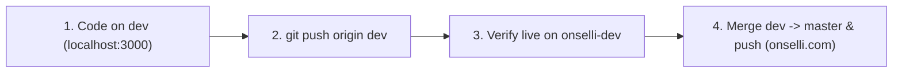

# Onselli

> High-conversion digital product commerce, course hosting, and membership platform tailored for modern African creators.

---

## 1. Environments & Branch Setup

A streamlined 2-branch workflow optimized for fast solo execution and zero overhead:

| Branch | Environment | Live URL | Database / Services | How You Use It |
| :--- | :--- | :--- | :--- | :--- |
| **`dev`** | **Staging & Local Workhorse** | [onselli-dev](https://onselli-dev) | Neon DB (Staging), Bachs Sandbox | **Your daily branch.** Code locally on `localhost:3000`. Pushing to `origin dev` instantly deploys to `onselli-dev` for end-to-end testing. |
| **`master`** | **Production** | [onselli.com](https://onselli.com) | Neon DB (Prod), Live Bachs/Stripe | **Protected production.** Merge `dev` here only when staging is verified and you are ready to ship live to real creators and buyers. |

---

## 2. Fast Solo Developer Workflow



### Daily Coding Routine (Stay on `dev`):
You don't juggle feature branches. Stay on `dev`, test on `localhost:3000`, and commit:
```bash
# Verify you are on dev
git checkout dev

# Code your feature, then commit directly:
git add <files>
git commit -m "feat(courses): add video upload progress indicator"
```

### Deploy to Staging (`onselli-dev`):
Whenever you want to test on the live staging link or preview on mobile:
```bash
git push origin dev
```
*Your staging environment (`onselli-dev`) automatically deploys.*

---

### Release to Production (`onselli.com`):
Once you verify that everything looks and works great on `onselli-dev`:
```bash
git checkout master
git merge dev
git push origin master
git checkout dev    # return to dev to continue coding
```
*Your live production site (`onselli.com`) is updated instantly.*

---

## 3. Design System & Anti-Slop Guidelines

1. **Restrained Color Palette:**
   - Brand Primary: Deep Emerald (`#006b4c`, hover `#00523a`)
   - Neutral Surfaces: `#ffffff`, subtle borders `#e5e7eb` / `#f3f4f6`, background `#f9fafb`
   - No novelty rainbow gradients, neon glow shadows, or fuzzy purple glassmorphism.
2. **Standard UI Primitives (`app/components/ui/`):**
   - `<Button variant="primary|secondary|tertiary|destructive" size="sm|md|lg" />`
   - `<Input />` & `<SearchInput placeholder="..." />`
   - `<Badge variant="published|draft|archived|active|failed" />`
   - `<Card />` & `<Panel />`
   - `<EmptyState />`
   - `<DropdownMenu />`
3. **Intentional Radii Scale:**
   - Standard elements: `rounded-lg` (8px)
   - Large cards / panels: `rounded-xl` (12px)
   - Badges & Pills: `rounded-full` (9999px)
4. **Data & Metrics:**
   - Always use `tabular-nums` for currency, pricing, and analytics numbers to prevent horizontal jitter.

---

## 4. Development Scripts

```bash
# Start local development server
npm run dev

# Run TypeScript typecheck (must pass with 0 errors)
npm run typecheck

# Build for production
npm run build

# Database schema migrations
npm run db:generate   # Generate migration SQL from schema
npm run db:migrate    # Apply migrations to database
npm run db:studio     # Launch visual Drizzle Studio

# Background job schedule sync
npm run jobs:sync-schedules
```

---

## 5. Architecture & Documentation Links

- [System Architecture](file:///docs/architecture.md)
- [Git Workflow Details](file:///docs/git-workflow.md)
- [Database & Auth Setup](file:///docs/auth-setup.md)
- [Bachs Payment & Payouts Architecture](file:///docs/bachs-payouts.md)
- [Full Product Specification](file:///docs/SPEC.md)
- [Development Plan & Milestones](file:///docs/development-plan.md)
