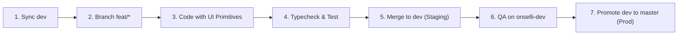

# Onselli

> High-conversion digital product commerce, course hosting, and membership platform tailored for modern African creators.

---

## 1. Environments & Deployment Targets

| Environment | Branch | Live URL | Database / Services | Purpose |
| :--- | :--- | :--- | :--- | :--- |
| **Production** | `master` | [onselli.com](https://onselli.com) | Neon DB (Prod), Live Bachs/Stripe, AWS SES | Real creators, live buyers, real money transactions. |
| **Staging** | `dev` | [onselli-dev](https://onselli-dev) | Neon DB (Staging), Bachs Sandbox, Test storage | End-to-end QA, staging verification, rehearsals. |
| **Local Dev** | `feat/*`, `fix/*` | `localhost:3000` | Local / Neon Dev branch | Active feature development and experimentation. |

---

## 2. Standard Feature Development Lifecycle

To keep the codebase clean, stable, and effortless to collaborate on, **all new feature work strictly follows this 7-step loop**:



### Step 1: Start from Clean `dev`
Always ensure your base staging trunk is up to date:
```bash
git checkout dev
git pull origin dev
```

### Step 2: Create a Dedicated Feature Branch
Branch off `dev` with a descriptive category and kebab-case name:
```bash
git checkout -b feat/course-curriculum-builder
# or for bug fixes:
git checkout -b fix/checkout-currency-rounding
```

### Step 3: Implement Using Shared UI Primitives
**Rule: Never write ad-hoc raw inputs, custom buttons, or unstyled tables.**  
Always use the standardized, anti-slop atomic components located in `app/components/ui/`:

- `<Button variant="primary|secondary|tertiary|destructive" size="sm|md|lg" />`
- `<Input />` & `<SearchInput placeholder="..." />`
- `<Badge variant="published|draft|archived|active|failed" />`
- `<Card />` & `<Panel />`
- `<EmptyState icon={...} title="..." description="..." action={...} />`
- `<DropdownMenu />`

### Step 4: Verify Locally (The 15-Second Health Check)
Ensure zero TypeScript compilation errors and clean formatting before touching git:
```bash
npm run typecheck
```

### Step 5: Commit with Conventional Commits
Keep commits atomic and focused. Use standard prefixes:
```bash
git add <changed-files>
git commit -m "feat(courses): add drag-and-drop module reordering in curriculum editor"
```

| Prefix | Usage | Example |
| :--- | :--- | :--- |
| `feat:` | User-facing feature | `feat(payouts): add automated Bachs payout schedule selector` |
| `fix:` | Bug fix | `fix(auth): resolve session expiry redirect loop` |
| `ui:` | Design system / styling | `ui(workspace): refactor product card badges and action menu` |
| `refactor:` | Code restructuring | `refactor(db): extract workspace membership query helper` |
| `db:` | Schema changes | `db: add curriculum_modules and lessons table migration` |
| `chore:` | Dependencies, tooling | `chore: upgrade next and tailwind dependencies` |

### Step 6: Merge to `dev` for Staging Verification
```bash
git checkout dev
git merge feat/course-curriculum-builder
git push origin dev
```
*Your hosting provider automatically deploys `dev` to **onselli-dev**.* Test the live flow end-to-end on staging.

### Step 7: Promote to `master` for Production Release
Once thoroughly verified on staging:
```bash
git checkout master
git merge dev
git push origin master
```
*Production automatically updates on **onselli.com**.*

---

## 3. Emergency Hotfixes (Production Only)

When a critical bug appears on live production (`onselli.com`):
1. **Branch off `master`**:
   ```bash
   git checkout -b hotfix/payment-webhook-race-condition master
   ```
2. **Fix and verify**:
   ```bash
   npm run typecheck
   ```
3. **Merge to `master` and push**:
   ```bash
   git checkout master
   git merge hotfix/payment-webhook-race-condition
   git push origin master
   ```
4. **Backport to `dev`** (so staging doesn't regress):
   ```bash
   git checkout dev
   git merge master
   git push origin dev
   ```

---

## 4. Design System & Anti-Slop Guidelines

1. **Restrained Color Palette:**
   - Brand Primary: Deep Emerald (`#006b4c`, hover `#00523a`)
   - Neutral Surfaces: `#ffffff`, subtle borders `#e5e7eb` / `#f3f4f6`, background `#f9fafb`
   - No novelty rainbow gradients, neon glow shadows, or fuzzy purple glassmorphism.
2. **Intentional Radii Scale:**
   - Standard elements: `rounded-lg` (8px)
   - Large cards / panels: `rounded-xl` (12px)
   - Badges & Pills: `rounded-full` (9999px)
3. **Data & Metrics:**
   - Always use `tabular-nums` for currency, pricing, and analytics numbers to prevent horizontal jitter.
4. **Iconography:**
   - Standardize Lucide icon stroke width at `1.5` or `1.75`.

---

## 5. Development Scripts

```bash
# Start local development server
npm run dev

# Run TypeScript typecheck (must pass with 0 errors)
npm run typecheck

# Build for production
npm run build

# Database schema migrations
npm run db:generate   # Generate migration SQL from schema
npm run db:migrate    # Apply migrations to database
npm run db:studio     # Launch visual Drizzle Studio

# Background job schedule sync
npm run jobs:sync-schedules
```

---

## 6. Architecture & Documentation Links

- [System Architecture](file:///docs/architecture.md)
- [Database & Auth Setup](file:///docs/auth-setup.md)
- [Bachs Payment & Payouts Architecture](file:///docs/bachs-payouts.md)
- [Full Product Specification](file:///docs/SPEC.md)
- [Development Plan & Milestones](file:///docs/development-plan.md)
